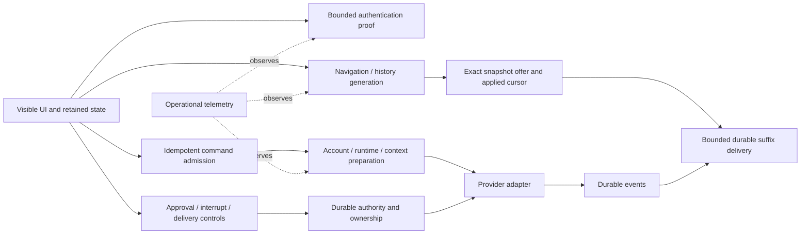

# Responsiveness investigation — 14 October 2026

## Evidence and boundaries

The reported incident is a 5–15 second unusable return to Mitzo, including an authentication screen, page switches and approvals. Investigation used independent source at accepted `210784cd`, compared with the installed release `c125be29`, read-only incident logs and Jaeger traces, and deterministic offline regressions. No production deployment, provider enrollment or model calls were performed.

The canonical staging check refused with uncertain custody. Its retained owner error explicitly says cleanup is unconfirmed and resources remain quarantined. No listener was observed on 3190. No lock, registry, owner record, launcher or native resource was changed. A valid retained-owner recovery and normal pipeline admission remain prerequisites to live acceptance.

Host observation reported memory pressure level 2, approximately 5.6 GiB swap and 26 GiB free disk. The resource gate refused local staging builds. Focused local tests use one worker and a 1 GiB Node heap; broad builds and browser acceptance belong in CI until host admission is restored.

Read-only storage inventory found 1,680 sessions and 3,473,553 durable events. The database was approximately 2.1 GiB plus a 261 MiB WAL; the five largest histories contained 34,191 / 31,484 / 30,265 / 27,242 / 26,712 events. These are scale observations, not measurements of the reported user's specific restore.

### Sampled traces

The query used Jaeger v3, service `mitzo`, 14:00–18:00 UTC, a bounded 100-trace selection including child spans. It is not a representative latency distribution or an end-to-end benchmark.

| Span                     | Samples |    Median |   Maximum | Interpretation                                                        |
| ------------------------ | ------: | --------: | --------: | --------------------------------------------------------------------- |
| `ws.reconnect`           |      15 |   2.61 ms |   5.95 ms | Handler duration excludes client history and acknowledgement waits    |
| `ws.switch_session`      |      27 |   0.98 ms |   9.64 ms | Excludes time waiting before dispatch                                 |
| `ws.send`                |       3 |   11.08 s |   13.43 s | Provider/preparation work must not own the navigation queue           |
| `http.auth.check`        |       5 |   1.96 ms |    2.03 s | Sparse server observations; does not measure pre-request client delay |
| `ws.permission_response` |      10 | 444.76 ms | 471.60 ms | Synchronous subscribers ran inside resolution                         |
| `tool.RequestWebAccess`  |      69 | 305.71 ms |   78.44 s | Includes human approval wait; not pure processing latency             |
| `knowledge.reconcile`    |       3 |    1.82 s |    1.88 s | Legitimate preparation work; not a reason to block existing UI        |

The frontend service was listed by Jaeger but returned no traces for 00:00–18:00 UTC. That is an observability gap, not proof of a fast client. The initial v1 Jaeger services route returned 404; v3 returned the data above.

The selected log contained an unhandled `ENOSPC` error in Pino's ThreadStream and 312 failed startup preflight lines. Source inspection places that preflight before backend startup: repeated entries indicate failed launch attempts, not hundreds of provider probes inside each HTTP request. Preserve the safety check; correcting deployment/image readiness requires the separately authorized deployment path. The same app log sample contained 1,677 repetitions of one invalid repository-path warning and 146 failed worktree-status warnings, indicating avoidable background work/log noise.

## Causes and implemented corrections

| Layer                  | Failure mechanism                                                                                                         | Correction / regression contract                                                                                                                                                 |
| ---------------------- | ------------------------------------------------------------------------------------------------------------------------- | -------------------------------------------------------------------------------------------------------------------------------------------------------------------------------- |
| Authentication         | Cold tracing import awaited before auth fetch, consuming the five-second auth budget                                      | Fetch starts immediately; telemetry initialization cannot gate auth; warm trace correlation retained                                                                             |
| Route return           | Protected route starts loading despite a still-valid existing verification                                                | Reuse the existing 30-second proof synchronously; no authorization lifetime extension                                                                                            |
| iOS biometric          | Credential validation loaded full session list and deleted saved credentials on temporary server failure                  | Lightweight auth check, bounded five-second wait; delete only explicitly rejected credentials                                                                                    |
| Client history         | Foreground during switch starts second restore, invalidates first completion and can strand loading state                 | Existing restore retains ownership; no second request                                                                                                                            |
| Transcript failures    | A stalled fetch or response body holds recovery indefinitely                                                              | Thirty-second network/body deadline, caller cancellation and visible retry state; unread history is never acknowledged                                                           |
| SSE delivery           | Snapshot ACK queued behind all earlier event HTTP ACKs                                                                    | Exact offered snapshot ACK uses independent connection-fenced request                                                                                                            |
| WS delivery            | Applied delivery ACK queued behind provider send admission                                                                | Authenticated cursor/offer controls bypass provider work queue                                                                                                                   |
| Navigation             | Page changes wait behind provider admission; its late completion can reclaim an obsolete view                             | Priority navigation with receive-time view generation and connection lifecycle fencing; background work keeps its original ownership                                             |
| Replay                 | Events withheld during snapshot restore wait for five-second periodic sync                                                | Accepted snapshot immediately delivers bounded suffix                                                                                                                            |
| Replay backlog         | Each additional 50-event batch waited for periodic sync                                                                   | Applying batch boundary immediately releases next bounded batch; no cursor jumps                                                                                                 |
| SSE acknowledgement    | An HTTP request per event multiplies reconnect traffic and creates one global queue                                       | Negotiated batches of at most 50 exact sequence numbers, per-session queues, 500-event total bound, contiguous server validation and reconnect on timeout/rejection              |
| Notifications client   | Visibility, native resume and SSE connect issue duplicate reads                                                           | Same-generation read sharing; authoritative mutation/change requests retain one trailing read                                                                                    |
| Metadata reads         | A hung fetch/body can own a shared read forever                                                                           | Ten-second bounded metadata reads, owner cancellation, late-result fencing and recovery; no mutation replay                                                                      |
| Background polling     | Multiple service-health consumers duplicate polling; hidden output views keep polling                                     | One shared health fallback, SSE priority and foreground-only output polling                                                                                                      |
| Approval resolution    | Notification feed/private-path scan and badge scheduling execute before response returns                                  | Keep durable resolution synchronous; defer and coalesce auxiliary refresh                                                                                                        |
| Server background work | Every two minutes, synchronous network Git fetch blocks all request handling                                              | Async Git subprocesses and one shared in-flight update check                                                                                                                     |
| Runtime readiness      | Nominal 30-second budget can be exceeded inside an inspection subprocess or sleep                                         | Deadline covers inspection and polling; caller cancellation retained                                                                                                             |
| Provider policy queue  | Canceled waiter waits behind previous operation before noticing cancellation                                              | Waiter rejects promptly without releasing or bypassing predecessor ownership                                                                                                     |
| Logging                | Operational transport error is unhandled and can terminate all sessions                                                   | Contain worker errors; bounded stderr fallback with explicit overflow/write-loss reporting, no retry loop; durable execution/approval audit remains independent                  |
| Calendar               | Failed reads become successful empty lists                                                                                | Propagate failure to existing error UI and allow recovery                                                                                                                        |
| Attention and outcomes | Read failures claim an all-clear state; failed actions leave swiped rows invisible                                        | Explicit error/retry states, restored rows after failed changes, and retained creation drafts on rejection                                                                       |
| Auth failures          | Express 4 does not consume rejected async login/logout handlers; revocation read failure can conceal an incomplete logout | Sanitized failure responses; logout clears the cookie and uses cryptographically verified identity solely to retry durable revocation; access authentication remains fail-closed |
| Session list           | Every activity broadcast recreates every row with repeated activity scans                                                 | Linear activity lookup; unchanged rows and lists retain identity                                                                                                                 |
| Observability          | Narrow handler spans conceal whole HTTP waits and process starvation                                                      | Shared API timing/error spans, sanitized slow-request logs, event-loop delay/memory observations and receive-to-dispatch queue wait on send spans                                |

The auth/tracing critical dependency was introduced in the 13 October auth/startup tracing changes (`#902`, `#913`). Notification machinery dates to `#721` and subsequent October UI work. The synchronous Git checker dates to April. Recent workload and lifecycle changes can expose older amplification paths; the evidence does not justify attributing the whole incident to one recent commit.

## Shared architecture contract

1. Visible UI, authentication, navigation and delivery acknowledgement must not depend on telemetry, notification scans or provider startup completing.
2. Shared protocol state is fenced by connection, session, offer and generation. Improving scheduling must not change account authority, replay old commands or allow a late provider completion to steal a newer selected view.
3. Durable approval/command state persists before dependent external effects. Auxiliary notification/UI refresh may be coalesced; authority must not be debounced or discarded.
4. Cancellation/deadlines cover both queue waiting and external operations. Canceling a waiter never releases another operation's lock. A timed-out mutation remains uncertain unless its durable receipt proves otherwise.
5. Bounded streaming batches use actual applied cursors. Backpressure and periodic repair remain, but the periodic repair timer is not the normal delivery scheduler.
6. Caches and in-flight reads are generation/account/credential scoped, bounded and recoverable. No model-specific UI workaround and no sharing credentials across accounts.
7. Operational logs and tracing are observers. Failure must be visible and bounded without becoming application failure; durable security/side-effect audit records keep their stronger persistence contract.

## Account, runtime and model coverage

| Path                                 | Shared evidence                                                                           | Limit                                                              |
| ------------------------------------ | ----------------------------------------------------------------------------------------- | ------------------------------------------------------------------ |
| OpenAI Responses/API                 | Shared approval web-access flow, durable capability execution, auth/UI/WS/SSE regressions | No live account call                                               |
| Codex subscription/native app-server | Same shared protocol plus native executable/readiness cases                               | No enrolled live native acceptance                                 |
| Google Vertex                        | Explicit account parameterization in web-access flow; shared lifecycle/UI changes         | No live Vertex call                                                |
| Anthropic Vertex / Messages path     | Explicit Vertex approval cases and common harness resolver                                | No live Messages/Vertex call                                       |
| Claude SDK                           | Common harness permissions and durable transport                                          | No real SDK execution in this investigation                        |
| OpenShell API/subscription/native    | Shared runtime readiness/cancellation suite and policy queue tests                        | Runtime-specific provider setup remains fenced                     |
| Guarded local Codex / Symposium      | Shared protocol controls preserve existing ownership fences                               | Enrollment, custody and end-to-end runtime acceptance are separate |

The fixes do not inspect model names; they apply below model selection. That establishes implementation neutrality, not exhaustive proof for every possible model/account/backend combination. Any future live test must explicitly select an account-supported Luna model and announce the exact model and charged account first. Unsupported Luna needs explicit approval; never fall back silently.

### Verification scope

Focused regressions exercise cold/warm authentication, visibility and native resume, concurrent history restore, slow provider admission with newer navigation, exact snapshot offers, multi-batch durable replay, rejected/stalled acknowledgements, stale connections, account binding, enrollment rotation, web-access approval, canceled policy reservations, unavailable notification reads and operational logger worker failure. The logger fixture injects `ENOSPC` in an isolated worker; it does not fill a disk. HTTP fixtures use temporary local listeners and mocked provider dependencies. No test invoked a real model.

The dedicated account/runtime parity run passed 233 tests across ten files. Protocol, harness and client project TypeScript compilation passed. Focused UI tests include the shared design guards. Changed offline browser scenarios cover auth/recovery and calendar/attention/outcome failures, but listing those scenarios is not execution or visual verification. Final full CI and Centaur review are still outstanding.

### Acceptance sequence

1. Publish the isolated branch through the existing repository PR flow once publication is authorized. Run full server/frontend checks and the offline browser matrix. Inspect the changed screens and resolve the exact-head Centaur findings before merge.
2. Reconcile canonical staging custody through its retained-owner procedure, restore host admission, then enqueue the accepted commit through the normal staging controller. An absent listener does not prove safe custody. No production credentials or alternate staging instance are an acceptable substitute.
3. Exercise foreground return, rapid page switches, approval/interrupt during provider startup, network loss and resumption, long histories, and expired/revoked credentials. Record UI-to-ready duration, auth network duration, queue wait, snapshot/ACK duration, request duration and event-loop delay together. Repeat the shared scenarios across each enrolled account/runtime adapter; use only an explicitly supported Luna model for actual generation.
4. Use those measurements to prioritize transcript projection/paging and background indexing. Add adapter-specific failures where they are observed rather than masking them with UI timers or weakening durable authorization.

## Remaining acceptance and architectural work

- Full CI, all offline browser fixtures and exact-head Centaur review are required. The baseline had one failed mobile motion geometry test; its trace showed font/ResizeObserver readiness changing between baseline measurements. The fixture now waits for stable font/layout geometry and retains exact assertions.
- Live latency budgets remain unmeasured because canonical staging is quarantined. Proposed acceptance targets on representative history: warm page/foreground content visible under 100 ms; no full auth screen for valid retained proof; independent control dispatch under 100 ms excluding network; no five-second replay floor; bounded queued cancellation; no silent read/mutation failures. These are targets, not claimed results.
- Full transcript reconstruction still scales with entire session event history. Evaluate durable transcript checkpoints plus immutable-cursor projections and incremental/paged history using the observed tens-of-thousands-event sessions. Bound caches by bytes and retain account/offer identity. Do not remove durable replay as a shortcut.
- Batch acknowledgement negotiation retains single-event compatibility with older servers/clients. The deterministic synchronous 100-event burst test uses two HTTP requests; that is not a real-network benchmark. Browser EventSource task scheduling and round-trip latency determine actual batch fill. Full browser acceptance remains required.
- Synchronous SQLite writes and legacy filesystem discovery remain in the main process. Measure new request/event-loop evidence before selecting worker isolation or precomputed projections. Do not blindly move durable writes across asynchronous boundaries.
- Notification feed/private-path scanning is deferred, not eliminated. Count-only queries and indexed visibility projections are follow-up candidates if the new measurements show pressure.
- Runtime provisioning-only synchronous subprocesses and lifecycle reservation APIs require separate ownership-aware cancellation work. Search's existing long-running contract intentionally permits completion beyond 90 seconds; do not replace it with an arbitrary short timeout.
- Startup image readiness failures, disk retention and whole-host pressure need operational reconciliation without deleting retained evidence or changing production implicitly.

The correct architectural direction is independent responsive control paths around durable authority, bounded work and measured projections. The current evidence supports targeted structural fixes first, not a wholesale replacement of provider adapters or persistence.
